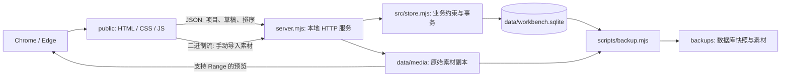
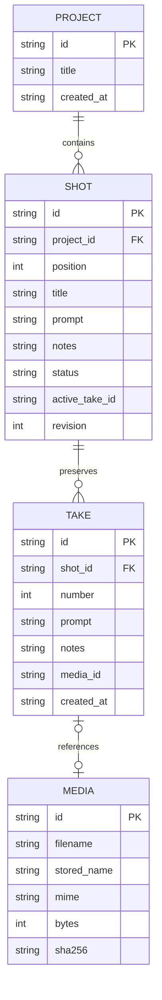

# 本地工作台架构 · v0.9

## 目标与选择

v0.9 在微动上加 2.5D 视差与流动，无 schema 变更：motion JSON 多了 depth_media_id（media 行，图片，POST /api/shots/:id/depth 上传，不建 take、不动 revision）和 camera（move none/push/pan/tilt/orbit、幅度 1–10、圈数 1–4 整数、焦点 0–100），旧 rig 正规化时补默认值；move≠none 必须有深度图。着色器先算区域位移，再对结果做视差：偏移 = (深度 − 焦点) × 幅度 × 镜头路径(t)，以 q = target − parallax(q) 迭代 3 次求反向映射，再按 1/(1 − 2·最大偏移/短边) 放大取样避免出边；镜头关闭时不进入这段，框外像素仍与原图一致。流动效果是两组沿支点方向行进的正弦波位移，时间频率为整数倍，循环无缝。

v0.8 增加静图微动。schema v7（v6 升级前生成 schema-v6-before-v7.sqlite）给 shots 加 motion 栏：JSON 记录来源图片版本、循环长度（1–10 秒）和最多 8 个区域（画面 1/10000 坐标、效果、强度、速度、羽化、支点），随片段 revision 保存，服务端校验并正规化。public/motion.js 用 WebGL 片元着色器做反向映射：每个像素按各区域羽化权重累加位移，框外权重为 0，取样点落在原像素中心，所以框外像素与原图一致；效果以整数圈数周期运动，循环首尾相同。导出用 WebCodecs VideoEncoder（H.264 Baseline，无 B 帧）离线逐帧编码，public/mp4.js 手写单轨 MP4（ftyp/moov/mdat，stts 固定帧长、stss 关键帧、单 chunk），与机器速度无关；不支持时退回 MediaRecorder 实时录制。导出结果作为新 take 上传，原图保留为微动来源。

v0.7 增加剪映式时间线与音频协作。schema v6（v5 升级前生成 schema-v5-before-v6.sqlite）：audio_tracks（类型 bgm/voice/sfx/other、静音、dB）、audio_clips（时间线 offset_ms、源文件 in_ms/out_ms、整段修改要求、采用版本）、audio_versions（同一片段多个媒体版本，供 A/B；时长由浏览器解码后回报一次）、audio_regions（源文件时间的框选与说明）、characters（角色 → provider/voice_id/声音描述）、shot_lines（每段台词，随片段草稿一起按 revision 保存）、tasks（音频任务快照与结果），jobs 增加 target 栏。src/audio.mjs、src/voices.mjs、src/tasks.mjs、src/herdr.mjs、src/export.mjs 分别负责；server.mjs 的上传抽成 receive()，镜头导入、素材库与音频共用。

时间线（public/timeline.js）在浏览器里用 Web Audio 解码、画波形、按 offset 排程播放，视频轨按片段顺序与时长（区间长度、探测的视频长度、图片 2 秒）排布并同步预览窗。拖动移动／裁剪、框选时间、Shift 多选都只写数据库，不改媒体。AiCut 不处理也不生成音频：任务快照写明要求、本地文件路径与 deliver 命令，agent 用 cli.mjs 导回新版本或新片段，再 complete。herdr 适配只调用 `herdr agent list` 与 `herdr agent prompt`（execFile，无 shell，名称白名单），忙碌或等确认的 agent 不推送。剪映导出：页面提交各段时长，服务端组装带绝对路径的 manifest，scripts/export_jianying.py 用 pyJianYingDraft 生成草稿；同一音轨重叠片段拆到额外轨，台词按段均分成字幕，放在画面约 72% 高度。

v0.6 增加画面框选：src/regions.mjs 校验并整组替换某段的框（PUT /api/shots/:id/regions，需 revision），public/regions.js / regions.css 提供框选对话框、卡片叠加层与标注图／mask 导出（浏览器 canvas 生成，服务端不解码媒体）。schema v5 增加 shot_regions（shot 外键、顺序、x/y/w/h 为画面 1/10000 整数、段内 start_ms、end_ms 为空表示到段尾、说明）；v4 升级前生成 schema-v4-before-v5.sqlite。每段最多 20 个框，宽高至少 0.5%。修改框会增加片段 revision，阻止旧 CLI 结果覆盖。任务快照的 regions 字段给出百分比坐标、方位词与时间；runner 指令要求只改框内并写明框外不变。分段时框按时间跨度复制到每个重叠的新段并裁到该段；不与任何新段重叠的框留在第一段原样保留。框只描述修改位置，不改像素，不做合成。

v0.5 提供可选内置 asset-library 扩展：src/library.mjs 管理素材与关联，public/library.js / library.css 提供开关、导入、搜索、试听和拖放；GET /api/extensions 返回能力声明，不加载外部代码。schema v4 增加 library_assets（media 外键、描述、标签、收藏、来源与 revision）及 shot_refs（shot/asset 外键、段内 offset_ms、使用说明）。v3 升级前生成数据库快照。

素材原件共用 data/media 不可变存储，备份沿用 SQLite＋media。关联不替换采用视频；解除关联不删除原件。分段事务会将范围内关联迁移到对应新片段并换算局部时间，重排不移动参考位置；超出新范围的关联保留并提示调整。修改描述／关联会增加相关片段 revision，阻止旧 CLI 结果覆盖；收藏不改变任务上下文。复制请求／任务快照包含参考元数据，不向模型附加媒体文件。不做同步混音或叠加导出。

v0.4 的 src/import-command.mjs 为现有本地 Agent 会话提供流式文件导入、均分与自定义时间点；未知时长通过可选 ffprobe 读取或明确提供 --duration，不猜测。导入与分段为独立服务请求，部分失败保留可检查的片段 ID。GET /api/shots/:id 提供现有版本详情；GET /api/projects/:id/stamp 返回轻量片段元数据。网页仅在空闲且无未保存编辑／弹窗时接收外部变更，再通过正常保存流程刷新，避免覆盖当前输入。

v0.3 增加了本地任务队列。schema v3 的 jobs 保存片段／项目 ID、provider、status、source_revision、不可变 snapshot、result、error 和时间戳。v2 升级前生成 schema-v2-before-v3.sqlite；片段级唯一索引阻止重复 queued/running 任务。

src/jobs.mjs 管理领取、完成、取消和采用；src/runner.mjs 串行启动 CLI，输入走 stdin，shell=false，限制超时和输出，并支持取消。Claude 禁用工具／MCP；Codex read-only；不绕过权限。API 不接受任意命令路径。

采用须匹配 source_revision，事务保存旧文字 take，再更新 Prompt／状态，不改备注及素材。SQLite 备份包含任务快照／结果；原始日志为辅助文件，不在标准备份中。服务重启不自动重新派工。

public/jobs.js 提供每段推送、状态轮询、历史预览及采用；cli.mjs 为现有会话提供 JSON 命令桥。自动派工是新进程；已有会话显式领取。接口与范围见 [CLI_BRIDGE.md](CLI_BRIDGE.md)。新增路由 GET /api/cli、GET /api/jobs、POST /api/shots/:id/jobs、GET /api/jobs/:id、POST /api/jobs/:id/claim、complete、cancel、apply；仅 manual 任务允许外部领取／完成。

本地单用户的「项目 → 片段 → 草稿／修改要求 → 素材版本」工作流。用户在订阅工具里生成素材并手动导回。核心工作台离线运行；可选 CLI 作业通过本机已登录的 Claude Code／Codex 处理文字修改请求，不直接连接模型 API 或生成视频。

参考来源（2026-11-03 文档核对，未安装这些上游项目）：

- [Clapshot](https://github.com/elonen/clapshot)：自托管媒体、SQLite 与文件素材分离、视频审阅和评论。参考它的存储边界；当前只实现片段备注，没有时间点画笔标注。
- [StoryBored](https://github.com/storybored-app/storybored)：项目／镜头卡片、多个 take、采用版本和确认状态。它是小型项目，只参考交互，不将它当成熟依赖。
- [Wonder Unit Storyboarder](https://github.com/wonderunit/storyboarder)：分镜组织和逐段检查的操作方式。
- [Node.js SQLite 文档](https://nodejs.org/docs/latest-v24.x/api/sqlite.html)：使用当前 Node 24 自带 SQLite，减少 Windows 首次安装依赖。存储集中封装在 `src/store.mjs`，以后需要替换驱动时不影响界面模型。

成熟通用部分采用 SQLite 事务、不可变素材、流式写入、HTTP Range、乐观并发和一致备份；无需为单人本地应用引入完整的协作审片平台。

## 组件



服务只绑定 `127.0.0.1`。静态资源与 API 同源，无 CDN、外部字体或第三方运行依赖。Node 24+ 是唯一运行环境依赖。

## 数据模型



- `shot.prompt/notes` 是下一版草稿，可以随时修改。
- `take.prompt/notes` 是创建版本当时的快照，服务不暴露修改接口。
- `active_take_id` 仅控制采用版预览。服务校验该版本必须属于同一片段，不用它反写草稿。
- take 的版本号按片段递增，与片段显示顺序无关。重排不会改变片段 UUID 或素材归属。
- 素材以 UUID 命名，原文件名仅用于显示。SHA-256 记录导入文件指纹；目前不按指纹去重。
- `todo / revise / review / approved` 对应待生成／待微调／待检查／已确认。新导入或文字快照进入待检查。

## 写入与恢复约束

草稿保存携带 `revision`，服务比较后更新为 `revision+1`。旧页面返回 HTTP 409，不静默覆盖。前端每片段串行提交，650ms 防抖；项目切换、排序和导入前先保存所有草稿。保存失败阻止依赖保存的操作，复制请求仍能从页面取回内容。

素材导入分两步：

1. 二进制流写入 `media/<UUID>.part`，计数和计算指纹；完成后同盘重命名。
2. 事务重新核对草稿 revision，建立素材记录、只读 take 和采用版指针。事务失败则清理本次未引用的文件。

进程异常退出可能留下 `.part` 或已重命名但未入库的孤立文件；它们不参与预览。初始版不自动删除，后续可加入显式可审阅的孤立素材清单。SQLite WAL 处理数据库事务的崩溃一致性。不是文件系统／数据库跨介质的原子事务。

备份先用 SQLite Backup API 创建一致数据库快照，再复制只增不删的素材。恢复需要整套目录。未来加入删除或垃圾回收前，必须重新设计备份与锁定协议。

## 本地接口

| 方法 | 路径 | 行为 |
|---|---|---|
| GET / POST | `/api/projects` | 列出／创建项目 |
| GET | `/api/projects/:id` | 项目及片段、版本详情 |
| POST | `/api/projects/:id/shots` | 添加空片段 |
| PUT | `/api/projects/:id/order` | 提交完整片段 ID 顺序 |
| PATCH | `/api/shots/:id` | 按 revision 修改草稿、状态或采用版 |
| POST | `/api/shots/:id/snapshot` | 保存当前文字为只读版本 |
| POST | `/api/shots/:id/split` | 按当前采用视频范围与 cuts_ms 创建多段，需要 revision |
| POST | `/api/shots/:id/trim` | 将 start_ms / end_ms 保存为新版本，需要 revision |
| POST | `/api/shots/:id/takes?filename=...` | 二进制素材导入；`X-Shot-Revision` 指定草稿版本 |
| GET / HEAD | `/media/:id` | 流式读取／Range 字节读取 |

写请求要求 `X-Workbench: 1`。检查 Host 与 Origin，禁止跨站网页写入。静态路径只开放明确列出的三个文件，素材只允许通过数据库 UUID 查找。此边界用于本机单人模式，不是多用户认证系统。

## 文件职责

```text
server.mjs             HTTP 路由、来源检查、流式素材导入和预览
src/store.mjs          SQLite 表、事务、业务校验、乐观并发
public/index.html      工作台结构与卡片模板
public/style.css       响应式布局、卡片和状态视觉
public/app.js          项目、编辑、自动保存、导入、复制请求
scripts/backup.mjs     数据库快照和素材备份
scripts/browser-smoke.mjs  本机 Chrome 验证脚本
tests/workbench.test.mjs   数据持久化与 HTTP 集成检查
start.cmd              Windows 启动入口
```

## 后续扩展顺序

1. 用真实 5–10 段素材验证修改、回填与重启后的检索。
2. 增加 Prompt 变更记录及两个版本并排播放；沿用 take，不覆盖历史。
3. 时间范围分段已实现；后续再接 FFmpeg 导出和 PySceneDetect 镜头检测。自动检测结果必须可手动改边界。
4. 需要文件夹监听时，用 manifest／片段 UUID 归属，不靠易变的显示编号猜测。
5. 大项目再评估缩略图、转码队列、异步 DB 驱动／Worker。初始版无速度或容量基准承诺。

现有生产工具可通过独立适配器导入；初始版不直接改写外部项目或渲染器。

## v0.2 时间范围与升级

schema v2 为 takes 增加 start_ms、end_ms、duration_ms 三个整数毫秒字段，null 表示原整条文件。分段、调整范围都创建不可变 take，多个 take 共用同一 media。原 take 不变。客户端提交浏览器读取的时长，服务端校验顺序与范围；未独立解码验证真实媒体时长。

分段事务先移动后续卡片位置，将第一段存入原卡片的新 take，再创建其余卡片和范围。失败时整笔回滚。各段继承 Prompt，只有第一段继承备注。调整单段范围不自动修改邻段，可能产生间隙或重叠。

旧 v1 首次升级前用 VACUUM INTO 生成 schema-v1-before-v2.sqlite（已存在则不覆盖），随后在事务中加字段并更新 user_version。更高版本数据库会被拒绝。完整备份仍需素材目录，不要用旧代码打开新版数据。

public/segments.js 负责分段对话框、均分／播放位置边界、范围编辑、单段循环和导航；public/segments.css 提供样式。播放依据 [currentTime](https://developer.mozilla.org/en-US/docs/Web/API/HTMLMediaElement/currentTime) 定位，结合 [requestVideoFrameCallback](https://developer.mozilla.org/en-US/docs/Web/API/HTMLVideoElement/requestVideoFrameCallback) 与 timeupdate 限制预览。它不是帧精确导出。
