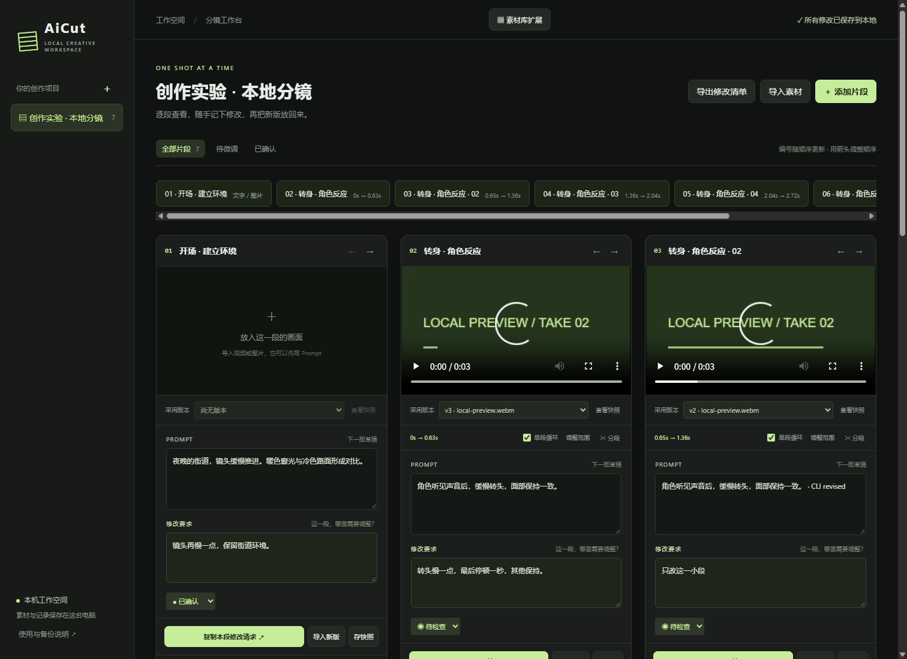
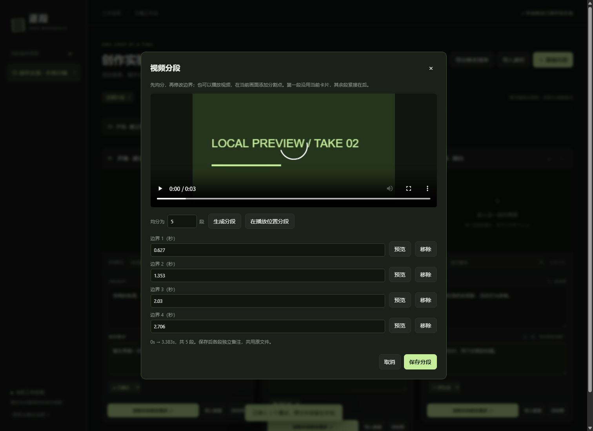
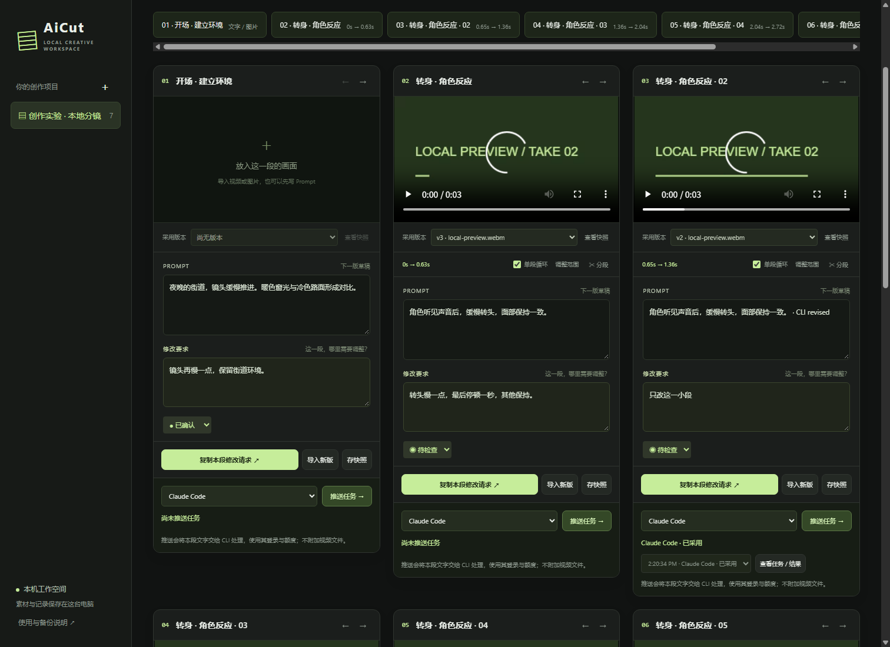

# Shot Workbench · 逐段

**Keep every shot, prompt and revision together — on your own computer.**

English | [简体中文](README.zh-CN.md)

Shot Workbench is a small local workspace for creators who generate content in other tools. Organize clips or text into shot cards, write a prompt and revision notes under each one, copy the complete request into your preferred tool, then import the next take.

The core workspace needs no AI API, account, cloud upload or npm dependencies. Optional CLI tasks use your installed, subscription-signed-in Claude Code or Codex CLI and send that shot's text to its provider. The current interface is in Simplified Chinese. This is an early `v0.4.0` implementation; production workflows still need testing.



## Features

- Multiple projects and ordered shot cards.
- Local image and browser-compatible video previews.
- Autosaved prompts and revision notes beneath each shot.
- Complete revision requests copied with project, shot and current-take context.
- Immutable prompt/notes snapshots for each imported take.
- Active-take selection without overwriting the next draft.
- Text-only snapshots, status filters and Markdown export.
- SQLite and original media backed up together.
- Per-shot local CLI dispatch, result preview and explicit adoption.

## Run locally

Install **Node.js 24 or newer**, download or clone this repository, and run this command from its directory:

```sh
npm start
```

Open **http://127.0.0.1:4317** in Chrome or Edge. Keep the terminal running; press Ctrl+C to stop.

On Windows, you can also double-click `start.cmd`. In PowerShell, use `npm.cmd start` if your execution policy prevents `npm.ps1` from running. No `npm install` step is necessary.

### Your first revision

1. Create a project (新建项目) and add a shot (添加片段).
2. Fill in **Prompt** and **修改要求** (revision request).
3. Click **复制本段修改请求** to copy the context into the tool you already use.
4. Generate or edit content outside Shot Workbench.
5. Click **导入新版** to attach the result as a new take. The previous take remains available.

You can also import several files to create one shot per file.

### Split a longer video

Import the full video, then click **✂ 分段** on its card. Choose five segments for a 30-second video to start with 0–6, 6–12, 12–18, 18–24 and 24–30 seconds. Edit a boundary in seconds, or click **在播放位置分段** to cut at the playhead. Remove unneeded boundaries before saving. Each segment must be at least 0.1 seconds; one split supports up to 100 segments.

The first segment uses the original card; the others are inserted directly after it. They share one media file and inherit the prompt. The first retains existing notes; new cards start with empty notes. The original full take remains in the first card's history. Existing later cards keep their order.

**调整范围** changes an individual segment's start/end as a new take. It does not move neighboring boundaries. Cards loop within the range by default; turn off **单段循环** to pause at the end. The horizontal navigator jumps between shots. Copied requests and Markdown exports include the source filename and range.



These are non-destructive playback ranges, not separately encoded clips. Automatic scene detection, frame-accurate cutting/export and stitched continuous playback are not included. Preview boundaries use approximate browser timing.

The first upgrade from schema v1 saves a pre-upgrade database snapshot in the data directory, then adds range fields transactionally. Back up the complete data and media before upgrading. Do not open upgraded data with v0.1 code.

## Data and backups

The server listens on `127.0.0.1` only. Media is copied from your browser to your local folder. There are no third-party web scripts or fonts. Optional CLI tasks contact the CLI provider for inference; the core workspace works offline.

```text
data/
  workbench.sqlite       Projects, shots, drafts, takes and media index
  media/                 Original media copies
backups/
  <timestamp>/           Consistent database snapshot plus media
```

Run a complete backup from the repository directory:

```sh
npm run backup
```

Use only a backup that reports `Backup complete`. To restore, stop the server, copy the complete timestamped backup directory to a **new** folder, and point `SHOT_DATA_DIR` at it before starting. Do not restore just the SQLite file. A Markdown export contains text only and is not a project backup.

PowerShell example after copying a complete backup to `restored-data`:

```powershell
$env:SHOT_DATA_DIR = Join-Path (Get-Location) 'restored-data'
npm.cmd start
```

On macOS/Linux, the equivalent start command is `SHOT_DATA_DIR=./restored-data npm start`. Windows is tested locally; the initial release also passed Windows/Linux CI. See GitHub Actions for each subsequent commit.

## Development

```sh
npm test
```

Twenty-five integration checks cover persistence, snapshots, segmentation, backup/restore, migration, task queues, CLI protocols, streaming import and missing-duration rejection. Tests never call a model.

An optional Chrome browser smoke test is available with `node scripts/browser-smoke.mjs`. It uses temporary data, imports synthetic PNG/WebM fixtures and writes a screenshot to `test-results/`. It defaults to the standard Windows Chrome path; set `CHROME_PATH` for another installation. This optional test is separate from CI.

See [architecture](ARCHITECTURE.md), [verification](VERIFICATION.md), [contributing](CONTRIBUTING.md) and [security scope](SECURITY.md).

CLI-specific checks and limitations are recorded in [CLI verification](docs/CLI_VERIFICATION.md).

## Current limits

- Browser codec support determines playback; importing MOV does not guarantee playback.
- Maximum file size is 1 GB. Large files, disk-full conditions and production workloads are not benchmarked.
- Ordering uses arrow buttons. Parallel take comparison, encoded clip export, folder watching and portable project import are planned, not implemented.
- Designed for one user on one computer. Multi-user authentication and network hosting are outside the current scope.

## Local CLI tasks

### Let your local agent import and split

An existing Claude Code/Codex session can use the command bridge directly; no manual file picker is required. With the server running:

```sh
node cli.mjs projects
node cli.mjs import PROJECT_ID "path/to/source.mp4" --segments 5 --duration 30
```

For an unknown duration, omit `--duration` and install ffprobe on PATH (or set `SHOT_FFPROBE_BIN` to its executable). Without ffprobe, a known duration is required for a full-video split; the command never guesses it. Ranged takes already retain their source duration for recursive splitting. Import copies only to the local server, not to an AI provider. The open browser refreshes idle shot changes automatically without discarding pending edits.

See [CLI bridge](CLI_BRIDGE.md) for creating projects, custom cuts and partial-failure recovery.

### Push a shot's text revision

Install and sign in to Claude Code and/or Codex CLI with your subscription account. Restart this server to see the CLI on PATH. Choose the CLI under a card and click **推送任务**. A task captures its prompt, notes, adopted-take metadata and time range. Tasks run one at a time. **查看任务 / 结果** previews the returned text; **采用结果** updates the prompt while preserving its old text snapshot and media.

If the shot changes after dispatch, adoption is blocked; copy the result to merge manually. Failed/interrupted tasks do not retry automatically. Restarting the service interrupts unfinished native tasks rather than spending quota again.

Native adapters check subscription-style login and reject API-key login, remove common API-key environment overrides and do not use permission-bypass flags. The CLI still uses its provider's network and subscription quota. Actual model inference is not exercised in development tests; local installation and login types were verified separately.

For an existing agent session, choose **外部 CLI 领取** and use the command bridge to read/claim/complete queued tasks. Native dispatch starts a new process, not an already-open chat. Current work is text-prompt revision, not editing video bytes. See [CLI bridge](CLI_BRIDGE.md).



## Acknowledgments and license

Interaction and storage ideas were informed by [Clapshot](https://github.com/elonen/clapshot), [StoryBored](https://github.com/storybored-app/storybored) and [Wonder Unit Storyboarder](https://github.com/wonderunit/storyboarder). This is an independent implementation; no upstream source was copied. Those projects retain their respective licenses and are not affiliated with this project.

Source is available under the [MIT License](LICENSE). Imported media remains subject to its own rights and licenses.
